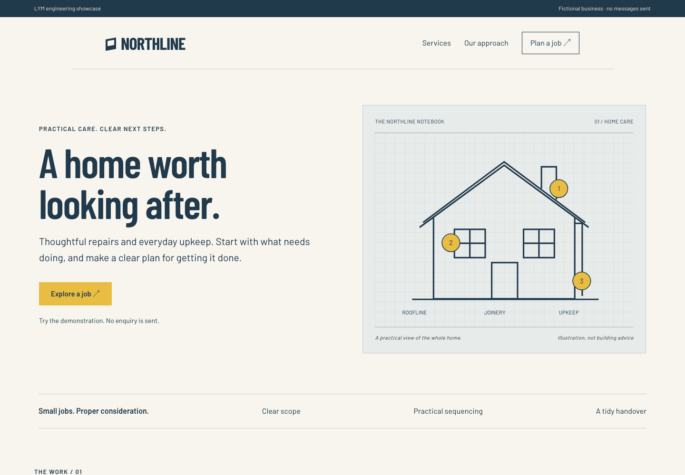

# Northline · WordPress website study

An original, fictional home-care business website by Love Yours Media. Six connected pages use native Elementor containers and widgets, a custom Hello Elementor child theme and an explicitly non-sending demonstration form.



## Reproduce locally

Requires **Node.js 24.18 or later and npm 11.16 or later** and internet access for the initial WordPress/theme/plugin downloads. No paid plugins or credentials are needed.

```sh
npm ci
npm start
```

Open http://127.0.0.1:9401/. The launcher binds to loopback only. This is an ephemeral WordPress Playground, not a deployment. Stop it with Ctrl+C. Restarting recreates the demonstration; editor changes are not a persistent delivery workflow.

WordPress 7.1.2, PHP 8.3, Hello Elementor 3.5.1, Elementor 4.3.3 and Playground CLI 3.1.56 are selected in the blueprint/lockfile. Third-party packages are downloaded from their official distributions.

## Edit the content

The local Playground administrator is the standard disposable `admin` / `password` account. Never expose this server or reuse those credentials. Open `/wp-admin/`, then Pages → Home → Edit with Elementor. Headings, text, buttons and containers are native editable elements. The house diagram and service rows are authored HTML widgets; the form is a shortcode. This is not an editable screenshot.

`content/pages.json` is the reproducible content source. `seed.php` is an explicit local setup operation. It requires a local administrator, activates the demonstration plugin/theme and inserts the six pages. Never run it on an existing client site.

## Design

Cream paper, condensed navy type and a yellow annotation system create a practical notebook identity. The house illustration is original SVG. Barlow fonts are local, with OFL notices in `theme/fonts/`.

## Scope and QA

Six pages tested at 1440px and 390px: one H1, no horizontal overflow, no browser exceptions and no automated WCAG A/AA violations. Form validation and successful non-sending completion tested in Chromium, Firefox and WebKit. See `docs/QA.md` for exact limits.

The demonstration form validates locally, clears entries and confirms that nothing was sent. The plugin blocks WordPress mail. It contains no CRM, payment or delivery integration. WordPress/Elementor themselves remain third-party software; this package is not a production security-hardening configuration.

Theme and plugin code are GPL-2.0-or-later. LYM's identity is excluded from reuse. Third-party software retains its own licences.
